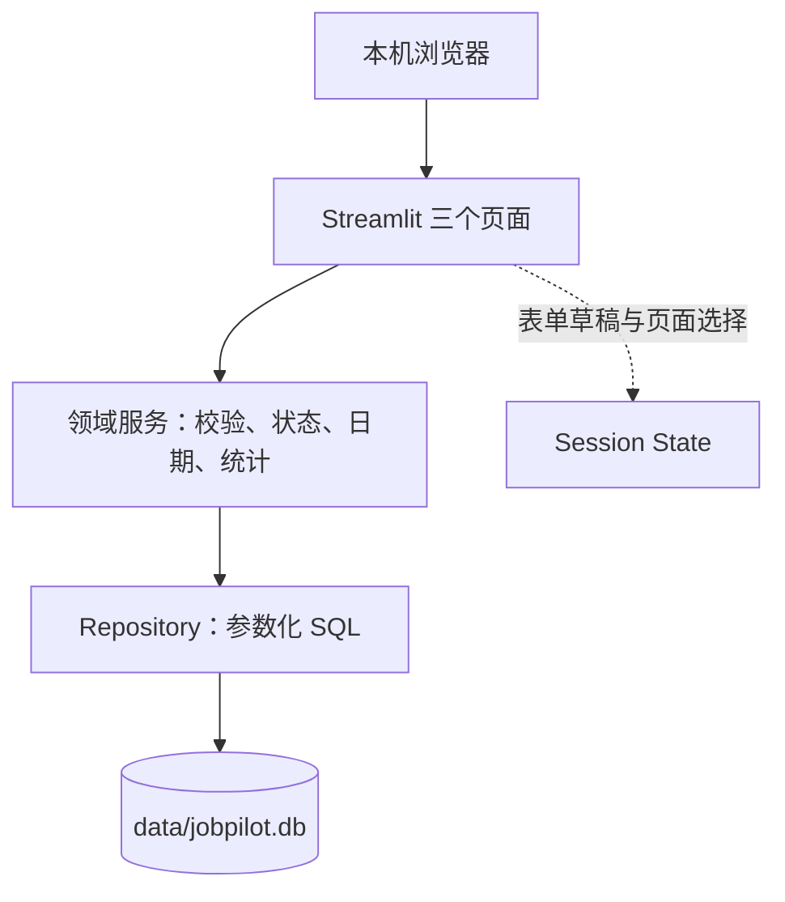

# JobPilot V1.0 技术方案

| 日期 | 输入依据 | 阶段 |
|------|----------|------|
| 2026-10-26 | [落地版 PRD](./JobPilot_PRD_V1.0.md)、[产品设计方案](./JobPilot_产品设计方案_V1.0.md) | 开发前方案，尚未实现 |

## 1. 结论与边界

采用 **Python + Streamlit + SQLite** 建立仅在本机运行的单人应用。三个 Streamlit 页面承担界面；独立的领域服务负责状态、日期和统计规则；SQLite 保存岗位。前端会话状态只保存表单草稿与页面临时选择，不承担长期存储。首版没有账号、云端、AI API、爬虫、站外通知或独立后端 API。

**开发前环境核对**：本机系统 Python 为 3.11.9、Streamlit 1.64.0、pytest 8.4.2。Streamlit 1.64.0 的 `st.dialog` 没有 `position` 参数，不能原生还原原型的右侧表单。[当前官方 `st.dialog` 文档](https://docs.streamlit.io/develop/api-reference/execution-flow/st.dialog)显示 1.66.0 支持 `position="right"`。2026-10-26 已在项目 `.venv` 中安装并验证 Streamlit 1.66.0，项目已初始化 Git；后续只用项目虚拟环境运行应用与测试。若未来环境无法安装锁定版本，改用原生居中对话框并记录与原型的差异，不采用依赖内部 DOM 结构的 CSS 补丁。

## 2. 技术选型记录

| 方案 | 适用性 | 维护与许可证 | 依赖、风险和集成成本 | 决策 |
|------|--------|--------------|----------------------|------|
| Streamlit + Python `sqlite3` | 三页表单、列表、统计可用一个 Python 工程实现；本机单人数据适合磁盘数据库 | Streamlit 官方仓库持续维护，Apache-2.0；SQLite 官方声明为公有领域 | 依赖少，调试简单；复杂自定义布局受 Streamlit 组件约束，需做浏览器走查 | V1.0 采用 |
| React + FastAPI + SQLite | 可以更精确还原原型与复杂交互 | React、FastAPI 官方仓库持续维护，均为 MIT；SQLite 公有领域 | 需要前端构建、API 协议、两套运行与测试；对当前个人 MVP 增加交付成本 | 暂不采用，若以后扩展多人/复杂交互再评估 |
| Streamlit + 云数据库 | 可服务公开在线演示和跨设备同步 | 取决于具体服务 | 需要账号、密钥、网络与隐私处理，超出冻结范围 | 暂不采用 |

参考：[Streamlit 多页面导航](https://docs.streamlit.io/develop/concepts/multipage-apps/overview)、[表单](https://docs.streamlit.io/develop/concepts/architecture/forms)、[会话状态](https://docs.streamlit.io/develop/concepts/architecture/session-state)、[应用测试](https://docs.streamlit.io/develop/concepts/app-testing)、[Python sqlite3](https://docs.python.org/3/library/sqlite3.html)、[FastAPI](https://fastapi.tiangolo.com/tutorial/first-steps/)、[React](https://react.dev/learn/installation)、[Streamlit 许可证](https://github.com/streamlit/streamlit)、[React 许可证](https://github.com/facebook/react)、[FastAPI 许可证](https://github.com/fastapi/fastapi/blob/master/LICENSE)、[SQLite 版权说明](https://www.sqlite.org/copyright.html)。上表的开发成本比较是根据项目范围作出的工程判断，并非这些文档给出的性能结论。

## 3. 架构与模块



建议代码结构：

```text
jobpilot/
  app.py                 # st.Page + st.navigation，公共主题与入口
  views/
    library.py           # 岗位库与新增/编辑/删除对话框
    board.py             # 五个进行中分组和终止折叠区
    overview.py          # 三项统计及日期事项
  domain/
    models.py            # 岗位和筛选条件的数据对象
    validation.py        # 字段长度、URL、日期、状态校验
    service.py           # CRUD、状态转换、统计与日期口径
  storage/
    db.py                # 连接、建表、schema 版本
    jobs.py              # 参数化 SQL 查询与写入
  tests/
    test_validation.py
    test_service.py
    test_repository.py
    test_ui.py
  data/                   # 本地数据库目录；数据文件不纳入版本控制
  .streamlit/config.toml  # 主题与本机监听配置
  pyproject.toml          # 锁定运行及测试依赖
  README.md
```

页面入口调用服务，不在页面代码里拼 SQL。服务接口以 `create_job`、`update_job`、`delete_job`、`list_jobs`、`set_status`、`get_overview` 为主；任何界面入口更新状态都走同一规则。SQLite 是唯一事实来源，页面切换后重新读取，避免缓存计数与数据库分歧。

## 4. 页面实现方案

| 页面/交互 | 实现方式 | 关键约束 |
|-----------|----------|----------|
| 侧边栏导航 | `st.Page` + `st.navigation`，入口文件统一注册三页 | 用官方导航切页，避免直接拼页面 URL 导致新会话 |
| 新增/编辑 | `st.dialog(..., position="right")` 内使用 `st.form` | 以已验证的 Streamlit 1.66.0 为前提；提交后校验与写入，成功 `st.rerun()`；失败保留草稿 |
| 岗位列表 | 以 `st.container`、`st.columns` 逐行呈现，提供每行按钮 | `st.dataframe` 不作为行操作主界面；搜索/筛选在服务层执行 |
| 删除确认 | 独立对话框显示公司与岗位名称，再提交删除 | 一次脚本运行最多打开一个对话框；取消不写数据库 |
| 进度看板 | 宽屏五列，卡片内 `st.selectbox` 更新状态；终止状态折叠 | 下拉后先写入数据库再重绘；失败保留原值；不做拖拽 |
| 求职总览 | 服务层返回三项数字与两组事项，页面只负责显示 | 不复用过期 Session State 统计结果；页面刷新时重算 |
| 原始链接 | 校验 `http/https` 后提供打开入口 | 只显示链接，不抓取其内容 |

`st.form` 会把一组输入在提交时一并发送到 Python 端；表单内部不用普通 `st.button` 作为取消动作，取消入口放在表单外。`st.session_state` 在浏览器会话结束后不会持久保存，故只能存草稿、筛选和当前编辑 ID。以上约束来自 [Streamlit 表单文档](https://docs.streamlit.io/develop/concepts/architecture/forms)和[会话状态文档](https://docs.streamlit.io/develop/concepts/architecture/session-state)。

视觉样式优先用 `.streamlit/config.toml` 的 `[theme]` 与 `[theme.sidebar]` 配置主蓝色、浅背景、深蓝侧栏；状态名称旁保留文本，必要时使用官方徽标组件。官方[配置文档](https://docs.streamlit.io/develop/api-reference/configuration/config.toml)支持侧边栏独立配色。首版以稳定可用和清晰层级为验收目标，不承诺与 HTML 原型逐像素一致。

## 5. 数据模型与持久化

首版一张 `jobs` 表，字段与 PRD 一致。建议建表约束示意如下，最终 SQL 在实现时按 SQLite 实际运行结果验证：

```sql
CREATE TABLE jobs (
  id INTEGER PRIMARY KEY,
  company TEXT NOT NULL CHECK (length(trim(company)) BETWEEN 1 AND 100),
  job_title TEXT NOT NULL CHECK (length(trim(job_title)) BETWEEN 1 AND 100),
  job_type TEXT NOT NULL CHECK (job_type IN ('校招', '实习')),
  city TEXT CHECK (city IS NULL OR length(city) <= 60),
  job_url TEXT UNIQUE,
  status TEXT NOT NULL CHECK (status IN
    ('收藏', '准备投递', '已投递', '测评/笔试', '面试',
     'Offer', '已拒绝', '已结束', '已放弃')),
  applied_at TEXT,
  deadline TEXT,
  next_action TEXT CHECK (next_action IS NULL OR length(next_action) <= 200),
  next_action_date TEXT,
  notes TEXT CHECK (notes IS NULL OR length(notes) <= 2000),
  created_at TEXT NOT NULL,
  updated_at TEXT NOT NULL,
  CHECK (next_action_date IS NULL OR coalesce(length(trim(next_action)), 0) > 0)
);
CREATE INDEX idx_jobs_status ON jobs(status);
CREATE INDEX idx_jobs_deadline ON jobs(deadline);
CREATE INDEX idx_jobs_action_date ON jobs(next_action_date);
CREATE INDEX idx_jobs_updated ON jobs(updated_at DESC, id DESC);
```

所有可选空字段统一写为 `NULL`，非空文本先去首尾空格。日期以 `YYYY-MM-DD` 保存；时间戳使用带时区的 ISO 8601 字符串。读写使用短生命周期连接、参数化 SQL 和事务；连接超时设为 5 秒，写入失败回滚并关闭连接。Python 官方文档说明 `sqlite3` 支持磁盘数据库、占位符参数和事务；[SQLite 官方文档](https://www.sqlite.org/lang_createtable.html)支持 `NOT NULL`、`UNIQUE`、`CHECK` 约束。数据库约束兜底，完整字段规则仍由领域服务校验。

数据库文件放在 `data/jobpilot.db`，加入 `.gitignore`。启动时检查 `PRAGMA user_version`：空库初始化为版本 1；未来迁移必须先备份再升级。首版不引入 ORM，也不把实时岗位数据提交到 Git。用户要备份时，关闭应用后复制数据库文件。

## 6. 核心业务规则

| 规则 | 服务层处理 |
|------|------------|
| 默认状态 | 新岗位为“收藏” |
| 状态跳级 | 九种状态之间可直接切换；不自动推断招聘结果 |
| 首次投递日期 | 第一次进入已投递、测评/笔试、面试、Offer，若为空则写当天；以后改状态不自动清空 |
| 累计投递数 | 对现存记录统计 `applied_at IS NOT NULL`；终止状态仍计入 |
| 当前面试数 | 当前状态等于“面试”的记录数 |
| 近期事项 | Asia/Shanghai 当天至第 7 天，含两端；只取非终止岗位 |
| 逾期事项 | 日期早于当天，且岗位非终止；不自动修改状态 |
| 重复链接 | 去首尾空格后，非空 URL 与另一记录完全相同时拒绝；无链接的岗位允许同名 |
| 搜索与筛选 | 搜索公司、岗位、城市；与类型、城市、状态筛选按“且”组合 |

统一通过 `datetime.now(ZoneInfo("Asia/Shanghai")).date()` 得到当天；本机已验证可解析该时区。部署到另一台 Windows 电脑时把 `tzdata` 作为明确依赖并锁定版本，避免运行环境缺少 IANA 时区数据。日期与状态计算只在服务层实现一次，避免三页口径不同。

## 7. 错误、安全与数据边界

- 应用只监听 `127.0.0.1`；不开放公网端口，不加入账号系统。监听地址和主题写入项目级 Streamlit 配置，并在启动后验证实际绑定地址。
- 表单对必填、长度、日期、URL 方案及主机名、状态枚举做校验；SQL 始终使用参数，不把用户输入拼入语句。
- 用户备注作为普通文本显示，不执行 HTML；只允许 HTTP/HTTPS 招聘链接。真实求职记录、数据库和潜在私密备注不进入仓库、测试样例或公开演示。
- 读失败时不展示缓存统计；写失败时回滚、保留表单输入或旧状态；删除需确认目标 ID 和岗位名称。
- 不记录原始备注、招聘链接全文到调试日志；日志只留错误类型、操作和必要的非敏感记录标识。
- 当前本机数据不具备自动备份与跨设备同步能力。公开演示版需要单独设计演示数据与持久化，不直接复用个人数据库。

## 8. 测试与验收

| 层次 | 验证内容 | 对应 PRD |
|------|----------|----------|
| 字段与服务单元测试 | 空白公司/岗位、非法 URL、日期边界、状态跳级、首次投递日期保留、统计口径 | AC-02、AC-03、AC-06、AC-07、AC-08 |
| SQLite 集成测试 | 临时数据库上的增删改查、重复链接、事务回滚、重启后读取、只读/锁定失败 | AC-01、AC-03、AC-04、AC-09 |
| Streamlit 页面测试 | 三页渲染、空状态、筛选、表单错误、跨页更新 | AC-05、AC-10 |
| 浏览器人工走查 | 右侧表单、五列看板、原始链接、键盘焦点及失败文案 | 产品设计方案第 6 节 |

可使用 [Streamlit 官方 AppTest](https://docs.streamlit.io/develop/concepts/app-testing) 配合 pytest 测试页面逻辑；但右侧抽屉的真实位置、焦点和跨页操作仍以浏览器走查确认。测试数据全部使用虚构公司与岗位。失败项需定位修复后重测，不把未运行记为通过。

## 9. 开发顺序、风险与回退

| 阶段 | 交付与验证 | 主要风险 / 回退 |
|------|------------|-----------------|
| 0. 环境 | 建 Git 仓库和 `.gitignore`；新虚拟环境验证 Streamlit 1.66.0 的右侧 `st.dialog`、主题和页面导航；锁定依赖 | 若抽屉不可用，采用居中对话框并记录原型差异；不依赖私有 CSS 选择器 |
| 1. 数据层 | 建表、迁移版本、校验与仓储；通过数据库测试 | 操作失败须回滚；用临时测试数据库隔离真实数据 |
| 2. 岗位库 | 新增、编辑、删除、搜索、筛选；验收 AC-01 至 AC-05 | 表单草稿不丢失；重复链接不产生第二条记录 |
| 3. 进度看板 | 状态分组及更新；验收 AC-06 | 跳级和终止状态口径与 PRD 保持一致 |
| 4. 求职总览 | 统计及日期事项；验收 AC-07、AC-08、AC-10 | 特别检查今天、第 7 天、空日期与终止状态 |
| 5. 收尾 | 错误路径 AC-09、浏览器走查、README、测试记录 | 数据库文件不提交；对外演示只用虚构数据 |

若后续发现 Streamlit 无法以可维护方式实现关键交互，先以已完成的需求和测试评估框架差距，再决定是否迁移前端；迁移会改变成本和周期，不在 V1.0 中预先展开。
